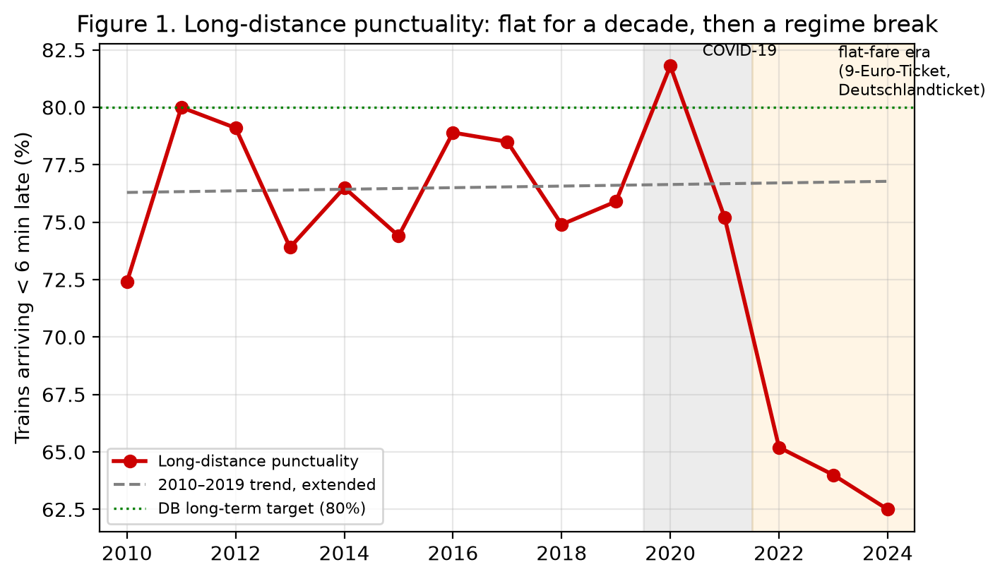
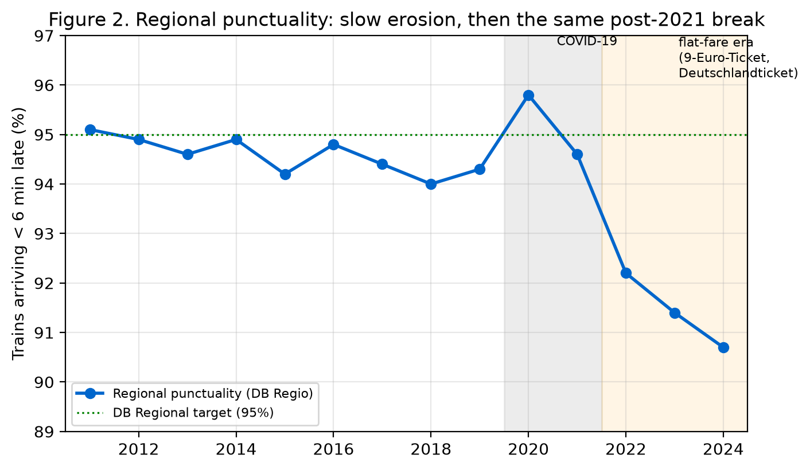
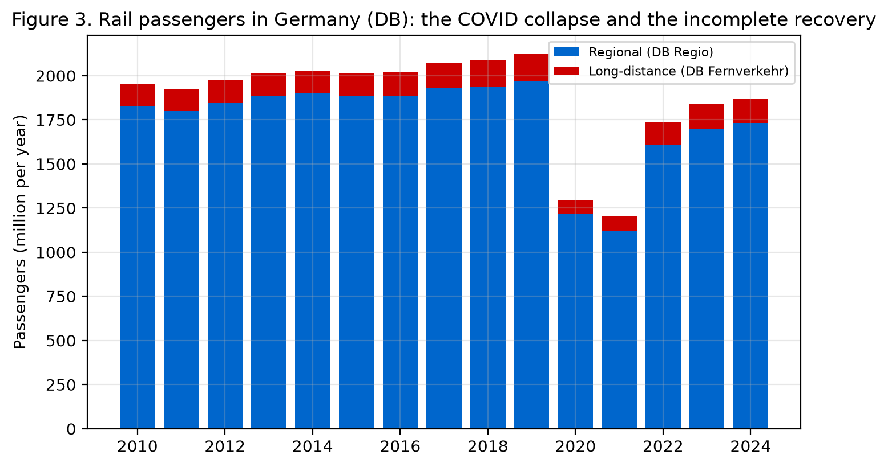
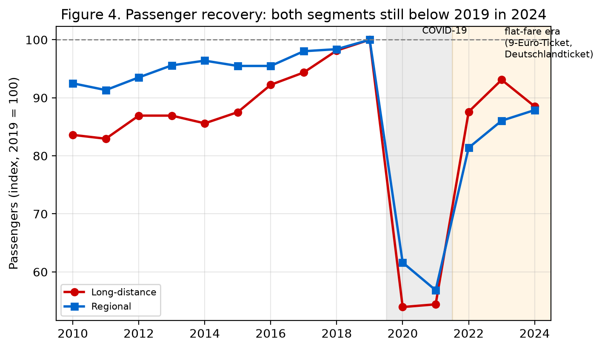
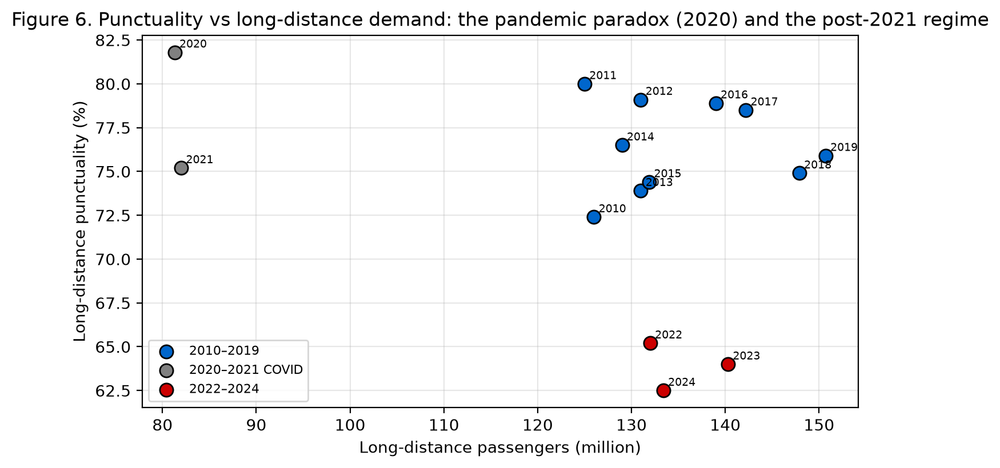
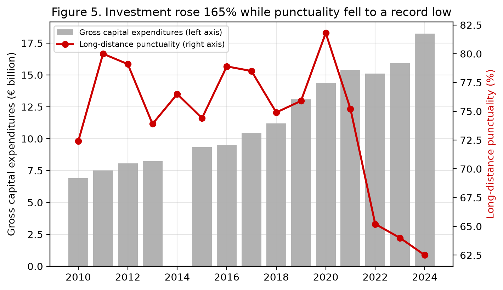
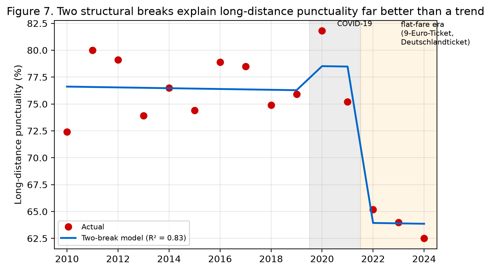
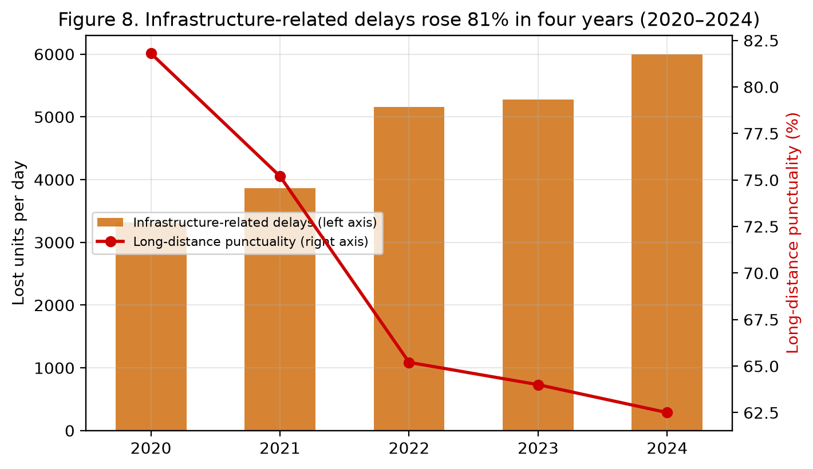

# From Pandemic Shock to Deutschlandticket: Structural Breaks in Deutsche Bahn's Punctuality and Passenger Performance, 2010–2024

**Rashed Rana**

Master's student, Artificial Intelligence for Industrial Applications, OTH Amberg-Weiden, Germany

*Manuscript prepared for journal submission. All data are drawn from Deutsche Bahn's published annual reports and official statistics; the dataset and code are openly available (see Data availability).*

## Abstract

Deutsche Bahn (DB), Germany's national railway, is widely described as being in a state of permanent crisis, yet the company's own published figures have rarely been analysed as one consistent time series. This paper assembles a fully sourced dataset of DB's official annual key figures for 2010–2024 — long-distance and regional punctuality, passengers by segment, revenues and gross capital expenditures — and tests whether the period is best described by gradual decline or by structural breaks around its two defining shocks: the COVID-19 pandemic (2020–2021) and the flat-fare era that began with the 9-Euro-Ticket (2022) and continued with the Deutschlandticket (from May 2023). Three results stand out. First, long-distance punctuality did not decline gradually: it was trendless from 2010 to 2019 (+0.04 percentage points per year, p = 0.91) and then collapsed by 13.4 points, from 75.9% (2019) to a record-low 62.5% (2024). A two-break model raises the explained variance from 0.34 to 0.83 and estimates the post-2022 level shift at −12.2 points (p = 0.003). Second, the pandemic produced a punctuality paradox: in 2020 long-distance ridership fell by 46.1% while punctuality reached its series maximum of 81.8%, and by the end of 2024 passengers had recovered to only 87.9% of their 2019 level. Third, investment and reliability decoupled: gross capital expenditures rose by 164.8% over the window to a record €18,247 million, while infrastructure-related delays increased by 80.8% between 2020 and 2024. A dedicated Deutschlandticket dummy finds no measurable level effect on regional ridership beyond trend and pandemic recovery in annual data (−5.4%, p = 0.36). The evidence points to a regime break in railway production — capacity, infrastructure condition and construction load — rather than to demand pressure or gradual decline.

**Keywords:** Deutsche Bahn; railway punctuality; structural break; COVID-19; Deutschlandticket; transport policy; Germany

## 1. Introduction

Few European companies attract as much sustained public criticism as Deutsche Bahn. Its long-distance trains are a byword for unreliability, and in March 2023 the German Federal Court of Auditors (Bundesrechnungshof) took the unusual step of publishing a special report describing a persistent crisis ("Dauerkrise") at the company and judging its "Strong Rail" strategy largely ineffective [13]. Yet most public debate relies on individual years, monthly press figures or anecdote. The company's own annual publications contain a consistent — if scattered — record of punctuality, ridership and investment stretching back well over a decade, and that record has rarely been assembled and analysed as a single dataset.

The period 2010–2024 is a natural laboratory because it contains two large, well-dated shocks. The first is the COVID-19 pandemic, which in 2020 removed nearly half of DB's long-distance passengers within a year and emptied the network. The second is Germany's flat-fare experiment: the 9-Euro-Ticket of June–August 2022, which sold around 52 million tickets [11][12], followed from 1 May 2023 by the Deutschlandticket, a nationwide local and regional public-transport subscription priced at €49 per month (raised to €58 in January 2025) and jointly funded by the federal and state governments with €1.5 billion each per year [12]. Both shocks plausibly shifted punctuality and ridership — but in opposite and partly offsetting ways, and their effects are entangled with a third development: an ageing infrastructure, a rising construction programme funded by the €86 billion LuFV III agreement for 2020–2029 [17], and surging investment.

This paper asks three questions. (1) Is DB's punctuality problem a long, gradual decline, or a recent structural break? (2) How did the pandemic and the flat-fare era shift passenger volumes, and how complete was the recovery by the end of 2024? (3) How do punctuality, demand and investment co-move once the breaks are taken into account? To answer them, we compile the dataset from DB's published annual key figures — every series documented to its source publication, cross-checked against the German Bundestag's official reproductions of DB's punctuality tables, Destatis and press agency reporting — and estimate ordinary least squares (OLS) trend models with level-shift dummies for the two breaks, in the spirit of Chow-type structural-break tests.

The contributions are threefold. First, to our knowledge this is the first study to analyse DB's *official annual key figures* as one consistent, fully sourced 2010–2024 panel of punctuality, passengers and investment; existing public work uses operational micro-data instead (Section 2.4). Second, we show that the punctuality collapse is a post-2021 regime break, not a trend: the pre-2020 series is statistically flat. Third, we document honestly what annual data can and cannot say about the Deutschlandticket: ridership growth resumed in its era, but a level effect beyond trend and pandemic recovery is not detectable at annual frequency — a null result that disciplines stronger claims made on both sides of the debate.

## 2. Literature review

### 2.1 Punctuality as the core quality indicator of railways

Punctuality — in DB's definition, the share of trains arriving less than six minutes behind schedule, with cancelled trains not counted as late — is the most visible quality dimension of passenger rail and the one DB itself uses as its headline steering metric, with long-term targets of at least 80% for long-distance and at least 95% for regional services [4][5]. Because DB publishes the figure annually and consistently, it supports long-window analysis; because cancelled trains are excluded, it if anything flatters the passenger experience, a point we return to in the limitations. The Federal Court of Auditors' 2023 special report provides the institutional backdrop: it attributes the crisis to decades of infrastructure underinvestment, a fragile network operated at its capacity limit, and a strategy that, in its judgement, had remained a largely ineffective slogan [13]. Our investment series lets us test whether the money side of that diagnosis has changed.

### 2.2 COVID-19 and public transport

The pandemic caused the deepest demand shock in the history of public transport. Tirachini and Cats [10], writing in 2020, assessed the immediate collapse of ridership, the fiscal exposure of operators and the risk that fear of infection would durably shift travellers to cars; subsequent experience across Europe confirmed a partial, slow recovery rather than a quick rebound. For railways the shock had a second, less discussed face: with trains and stations emptied, operations became easier, and punctuality *improved*. DB's 2020 figures are an extreme case of this mechanism — its long-distance punctuality that year was the best in at least fifteen years — and any analysis that pools the pandemic years into a trend will misread both the demand and the quality series. We therefore model 2020–2021 as a distinct regime.

### 2.3 Fare policy and the Deutschlandticket

Germany's flat-fare experiment began as crisis policy: the 9-Euro-Ticket (June–August 2022) was an energy-price relief measure that also functioned as the largest fare experiment in German transport history, selling roughly 52 million tickets [11][12]. Its permanent successor, the Deutschlandticket, launched on 1 May 2023 at €49 per month; the transport association VDV reports around 11 million subscribers and roughly a 10% ridership increase in regional and local transport in its first year [12]. The first rigorous impact study, by Liao et al. [11], uses mobile geolocation data and finds that the Deutschlandticket increased public-transport visit numbers by 26.2% and travel distances by 11.8% in its first month. These figures are not directly comparable to ours: they measure short-run responses from a depressed post-pandemic base at monthly frequency, whereas we observe annual business-unit volumes. Whether the ticket lifted DB's regional ridership *durably and beyond the recovery path* is precisely the question our break model addresses — and, at annual frequency, cannot confirm.

### 2.4 Related work and data projects

Three public projects analyse Deutsche Bahn data, all from operational micro-data rather than annual reports. The *deutsche-bahn-data* project [15] collects timetable and delay data from DB's public API several times a day — for about 100 major stations from July 2024 and for all stations from November 2025 — and publishes an open dataset and statistics website explicitly intended to allow independent validation of DB's official statistics; it is data infrastructure, not a company-performance study, and its window begins in 2024. *Splines/deutsche-bahn-analysis* [16] analyses DB delays from operational data (last updated 2023). David Kriesel's *BahnMining* [14] mined years of scraped timetable data and presented the delay patterns in a widely noted 2019 conference talk. None of these assembles DB's published annual key figures, estimates structural-break models, or covers 2010–2024; the present study is complementary to them — an audit of the company's own reported record, with every figure traceable to its publication.

## 3. Data and methods

### 3.1 Data

The dataset (Table 1) contains eight annual series for 2010–2024, transcribed from DB's publications: *Daten & Fakten 2013* [1], *Facts & Figures 2019* [2], *Facts & Figures 2020* [3], *Facts & Figures 2024* [4], the *Integrated Report 2024* [5] and earlier Geschäftsberichte and annual-results press releases. Punctuality values were cross-checked against the Federal Government's answers to parliamentary questions, which reproduce DB AG's own tables (Bundestag Drucksachen 19/1983 and 19/9205) [6][7], against Destatis' count of 151 million long-distance passengers in Germany in 2019 (all operators; DB alone reports 150.7 million) [8], and against dpa reporting of DB's official releases [9]. Where cross-checks disagreed, the discrepancy and our resolution are documented in the dataset's source file; the anchor years 2015–2017 and 2022–2024 agree exactly across all sources.

Two cells are deliberately empty. Regional punctuality for 2010 exists only for a different aggregate (all DB local transport, 91.5%), which is not comparable with the DB Regio business-unit series published from 2011 (95.1%); the regional series therefore starts in 2011. Gross capital expenditures for 2014 appear in none of the multi-year summaries consulted (DB's 2015 press release implies ≈ €9.1 billion via a reported +2.4% increase, but an implied value is not a published value). No value in the dataset is estimated, interpolated or carried over.

### 3.2 Definitions and comparability

Punctuality is DB's statistic: a train counts as punctual if it arrives less than six minutes late; cancelled trains are excluded rather than counted as unpunctual [4]. Regional punctuality from 2020 is published in a third-weighted representation [4]. Passenger figures are DB business-unit volumes: long-distance (DB Fernverkehr) and regional (DB Regio, including S-Bahn), whose sum matches DB's published "rail passengers in Germany" total (component sums can differ from the published total by ±1 million through rounding). Revenues are *not* scope-consistent: DB restated its presentation repeatedly (IFRS 16 from 2019; DB Arriva as a discontinued operation from 2022; DB Schenker from 2023), so the 2023–2024 revenue figures cover continuing operations only and are not comparable with earlier years. We therefore use revenues descriptively only and exclude them from all regressions. Gross capital expenditures are group-wide (rail and logistics), the only investment series DB publishes consistently over the window.

### 3.3 Methods

Three complementary tools are used. (i) *Trend estimation*: OLS of each series on time over sub-periods (pre-COVID, full window), reporting slopes with p-values and R². (ii) *Two-break models*: OLS of the form y = a + b·t + c·COVID + d·POST2022 (+ e·DTICKET), where COVID = 1 for 2020–2021, POST2022 = 1 for 2022–2024 and DTICKET = 1 for 2023–2024; passenger volumes are modelled in logs so dummy coefficients read as approximate percentage shifts. Joint significance of the break dummies against the no-break trend model is assessed with an F-test (a Chow-type test with known break dates). (iii) *Descriptive recovery and correlation analysis*: 2024 values as a percentage of 2019, and Pearson correlations between punctuality, passengers and investment, computed on the full window and pre-2020 separately. With 14–15 annual observations, all inference is indicative rather than definitive; we report exact p-values and avoid causal language where the design cannot support it. A companion SQL analysis (nine documented queries on a SQLite build of the dataset) reproduces the period averages, year-on-year changes and recovery ratios independently of the Python pipeline.

**Table 1. Key indicators, selected years (source: dataset compiled from DB publications [1]–[5]; see data documentation).**

| Indicator | 2010 | 2019 | 2020 | 2021 | 2022 | 2024 |
| --- | --- | --- | --- | --- | --- | --- |
| Punctuality, long-distance (%) | 72.4 | 75.9 | 81.8 | 75.2 | 65.2 | 62.5 |
| Punctuality, regional (%) | n/a | 94.3 | 95.8 | 94.6 | 92.2 | 90.7 |
| Passengers, long-distance (mn) | 126 | 150.7 | 81.3 | 82.0 | 132.0 | 133.4 |
| Passengers, regional (mn) | 1,824 | 1,972 | 1,215 | 1,121 | 1,605 | 1,733 |
| Passengers, rail Germany (mn) | 1,950 | 2,123 | 1,297 | 1,203 | 1,737 | 1,867 |
| Revenues (€ mn) | 34,410 | 44,430 | 39,901 | 47,075 | 52,085 | 26,203* |
| Gross capital expenditures (€ mn) | 6,891 | 13,093 | 14,402 | 15,387 | 15,098 | 18,247 |
| Infrastructure-related delays (lost units/day) | n/a | n/a | 3,317 | 3,861 | 5,162 | 5,998 |

*Continuing operations only — not comparable with earlier years (Section 3.2).

## 4. Results

### 4.1 A flat decade, then a break (long-distance punctuality)

Figure 1 plots long-distance punctuality over the window. The pre-pandemic decade shows no direction at all: annual values oscillate between 72.4% and 80.0% around a mean of 76.5%, and the OLS trend for 2010–2019 is +0.04 points per year (p = 0.91, R² = 0.002). The pandemic year 2020 produced the series maximum (81.8%), reported at the time as the best result in fifteen years [9]. Then, in the first full post-pandemic year, punctuality fell by ten points in a single step — to 65.2% in 2022 — and continued down to 64.0% (2023) and 62.5% (2024), the lowest value in the published record: dpa's series reaches back to 2003 and its best year, 2004, recorded 84.3% [9]. Relative to 2019 the loss is 13.4 points; extending the flat 2010–2019 trend predicts 76.8% for 2024, a shortfall of 14.3 points. Only three years in the window fall below 70% — 2022, 2023 and 2024 (SQL query Q2).

Regional punctuality (Figure 2) tells the same story at a higher level and with a different pre-history: a slow, statistically significant erosion from 95.1% (2011) to 94.3% (2019) (−0.11 points per year, p = 0.013), a pandemic maximum of 95.8% in 2020, and then a fall to 90.7% by 2024 (−3.6 points vs 2019) — below DB's 95% long-term target in every year since 2021 and approaching the bottom of even its 90–95% target corridor for 2027 [4]. The two punctuality series are almost perfectly correlated across the window (r = 0.97), pointing to common, network-level drivers rather than segment-specific management.

### 4.2 Two-break models

Table 2 reports the break models. For long-distance punctuality, moving from a plain trend (R² = 0.34) to the two-break specification raises R² to 0.83, and the break dummies are jointly highly significant (F = 15.6, p < 0.001). The estimated post-2022 level shift is −12.2 points (p = 0.003); the COVID dummy is small and insignificant (+2.3, p = 0.44) because it averages the exceptional 2020 (+5.9 points vs 2019) with the already-normalising 2021. The residual time trend is zero (−0.04, p = 0.90): conditional on the breaks, there is no gradual decline to explain — the collapse *is* the break. Figure 7 (Section 4.5) shows actual versus fitted values. The regional punctuality model fits even better (R² = 0.94; F = 35.2, p < 0.001), with a significant slow trend (−0.14 points per year), a positive COVID shift (+1.4 points, p = 0.012) and a post-2022 shift of −2.1 points (p = 0.003).

**Table 2. Two-break OLS models (dependent variables as shown; t = years since 2010; COVID = 2020–2021; POST2022 = 2022–2024; DTICKET = 2023–2024).**

| Model | Trend / yr | COVID | POST2022 | DTICKET | R² | F (breaks) |
| --- | --- | --- | --- | --- | --- | --- |
| Punctuality, long-distance (pp) | −0.04 (p = 0.90) | +2.27 (p = 0.44) | **−12.24 (p = 0.003)** | — | 0.83 | 15.6 (p < 0.001) |
| Punctuality, regional (pp) | −0.14 (p = 0.03) | +1.37 (p = 0.012) | **−2.06 (p = 0.003)** | — | 0.94 | 35.2 (p < 0.001) |
| ln passengers, long-distance | +2.0% (p < 0.001) | −46.5% (p < 0.001) | −15.7% (p < 0.001) | — | 0.99 | 381.9 (p < 0.001) |
| ln passengers, regional | +0.9% (p = 0.007) | −41.3% (p < 0.001) | −17.6% (p < 0.001) | — | 0.98 | 254.0 (p < 0.001) |
| ln passengers, regional (DT variant) | −0.3% (p = 0.54) | −36.2% (p < 0.001) | — | −5.4% (p = 0.36) | 0.92 | 48.0 (p < 0.001) |

For passenger volumes (log models), the COVID shifts are enormous and precisely estimated: −46.5% for long-distance and −41.3% for regional ridership relative to trend. Equally important is the sign of the POST2022 coefficients: even in 2022–2024, ridership ran 15.7% (long-distance) and 17.6% (regional) *below* the pre-pandemic trend path — the flat-fare era, in level terms, had not closed the pandemic gap by the end of the window. The Deutschlandticket variant makes this concrete: replacing the post-2022 shift with a dedicated DTICKET dummy (2023–2024) yields a coefficient of −5.4% that is far from significant (p = 0.36). At annual frequency there is no detectable Deutschlandticket level effect on DB's regional volumes beyond the recovery path itself.

### 4.3 The pandemic paradox and the demand collapse

Figure 3 and Figure 4 show the demand side. Total DB rail passengers in Germany fell from 2,123 million (2019) to 1,297 million (2020, −38.9%) and 1,203 million (2021). The long-distance segment fell furthest (−46.1% in 2020) — consistent with long-distance travel being the most discretionary and the most restricted. The same year recorded the best punctuality of the window in both segments. Figure 6 (scatter of long-distance punctuality against long-distance passengers, coloured by regime) makes the mechanism visible: the pandemic points sit up and to the left (few passengers, high punctuality), the post-2021 points down and to the middle (returning passengers, collapsed punctuality), and the pre-2020 cloud shows no slope at all. Over the full window the raw correlation between long-distance punctuality and long-distance passengers is −0.27 and insignificant (p = 0.33); between regional punctuality and regional passengers it is −0.05 (p = 0.87). Demand pressure alone therefore does not explain the punctuality regime: 2024 combined *fewer* passengers than 2019 with the *worst* punctuality on record.

### 4.4 Recovery and the flat-fare era

The recovery through 2024 is real but incomplete in every segment (SQL query Q6): rail passengers in Germany reached 87.9% of 2019 (1,867 vs 2,123 million; still 256 million journeys missing), long-distance 88.5% (133.4 vs 150.7 million) and regional 87.9% (1,733 vs 1,972 million). The regional path shows the fare experiments clearly in growth rates — +43.2% in 2022, the year of the 9-Euro-Ticket summer and the post-Omicron reopening, then +5.7% in 2023, the Deutschlandticket's first (partial) year, and +2.1% in 2024 — but growth from a trough is not recovery of levels: at the 2024 growth rate, regional ridership would need about six more years to regain 2019. It also remains far below DB's own long-term regional target of more than 2,500 million passengers [4]. Long-distance ridership, which the flat fares do not cover, rebounded +61.0% in 2022 but then stalled (140.3 million in 2023) and fell 4.9% in 2024 — a year in which DB itself cites strikes in the first quarter and the five-month closure of the Riedbahn corridor for general renovation [5]. Period averages underline the regime shift (SQL query Q3): mean long-distance punctuality was 76.5% in 2010–2019, 78.5% in the COVID years, and 63.9% in 2022–2024.

### 4.5 Investment rose; the infrastructure deteriorated

Figure 5 overlays gross capital expenditures with long-distance punctuality. Investment rose almost monotonically: from €6,891 million (2010) to €13,093 million (2019) and a record €18,247 million (2024), +164.8% over the window; the five post-2019 years alone account for €79.1 billion against €53.6 billion in 2015–2019, and the fourteen available years sum to €163.3 billion. The naive correlation with punctuality is negative (r = −0.60, p = 0.025), but it decomposes revealingly: before 2020 the correlation is zero (r = +0.01, p = 0.97). Money and failure did not cause each other year by year; both surged in the same post-2019 regime. DB's own infrastructure-delay metric — lost units per day attributed to the infrastructure, published under its S3 restructuring programme — shows what the money is chasing: it rose from 3,317 (2020) to 5,998 (2024), +80.8% (Figure 8), tracking the punctuality collapse almost one-for-one (r = −0.98 across the five available years; descriptive only). The pattern is consistent with the Federal Court of Auditors' diagnosis [13]: a backlog accumulated over decades, a network run at its capacity limit, and a construction programme whose works themselves disrupt operations — investment as both remedy and, in the short run, symptom.

## 5. Discussion

Three implications follow. First, for the public debate: "decline" is the wrong word for what happened to DB's punctuality before 2020, and the right frame afterwards is a *production* crisis, not a demand crisis. A decade of flat — mediocre, but stable — performance ended when the network's condition, the post-pandemic timetable and the construction load combined into a new regime in which even below-2019 demand could not be served reliably. Policy that argues about individual timetable years misses the level shift: returning to the pre-2020 plateau requires closing a gap of roughly 12–14 points, and DB's own targets (75–80% long-distance punctuality by 2027 under the S3 programme [4]) implicitly concede that the 80% long-term ambition is not near-term.

Second, for fare policy: the flat-fare era coincided with resumed growth in regional ridership, but the strong claims made for the Deutschlandticket — and against it — are not settled by annual aggregates. Our null result for the DTICKET dummy does not contradict micro-level studies that find sizeable first-month responses [11] or association reports of double-digit first-year growth [12]; both measure growth from a depressed base. What the annual record shows is that by the end of 2024 the level gap to 2019 remained about 239 million regional journeys, and that the recovery's *pace* was already slowing (+2.1% in 2024). Monthly or station-level designs — such as the open operational datasets now being published [15] — are the right tools to identify the ticket's causal effect; annual report data can only bound it.

Third, for investment policy: the post-2019 co-movement of record spending and record unreliability should not be read as evidence that investment fails. The pre-2020 correlation is zero, and the infrastructure-delay series suggests the spending is responding to deterioration that accumulated earlier; the relevant question — which this dataset cannot answer — is whether the renewal programme's disruption is being bought at the lowest possible operational cost, and over what horizon the reliability returns appear.

## 6. Limitations

The analysis uses annual data with only 14–15 observations per series; break tests with known dates on such samples have limited power, and p-values should be read as indicative. Annual aggregation hides within-year dynamics that matter for the fare question (the 9-Euro-Ticket covered three months of 2022; the Deutschlandticket eight months of 2023). The punctuality statistic excludes cancelled trains, so passenger-experienced reliability is worse than the figures analysed here. Regional punctuality from 2020 uses DB's third-weighted representation, and several early passenger values are published rounded to whole millions; small seams in the series cannot be excluded, and the full source audit (including two cross-source discrepancies and how they were resolved) is documented with the dataset. Revenue figures change scope over the window and were excluded from the models. Capital expenditures are group-wide rather than rail-only, and their punctuality association is regime-driven, as shown; no causal claim about investment is made. Finally, DB is a near-monopoly provider in German long-distance rail, so the results describe one incumbent in one institutional setting.

## 7. Conclusions

Assembled as one series, Deutsche Bahn's own published figures tell a sharper story than the familiar narrative of endless gradual decline. Long-distance punctuality was flat for a decade, spiked to a record high on empty pandemic railways, and then broke to record lows from 2022 — a level shift of about twelve percentage points that two-break models detect unambiguously (F = 15.6, p < 0.001). Passengers, by contrast, had recovered only to about 88% of their 2019 level by the end of 2024, and the Deutschlandticket era shows up in the annual data as resumed growth, not as a measurable level effect. Investment reached record levels in the same years, chasing an infrastructure whose DB-measured delay burden rose by four fifths in four years. For policy, the finding reframes the task: Germany does not face a railway in slow decline but a railway that crossed into a worse operating regime after 2021 — and reversing a regime, as the infrastructure-delay series warns, is slower than reversing a trend.

## Data availability

The compiled dataset (`data/db_performance.csv`), its full source documentation (`data/sources.md`), all analysis and figure code, the SQL queries and their results are available in the public repository: https://github.com/rashedrana/deutsche-bahn-performance-analysis. Primary sources are the Deutsche Bahn publications listed in the references.

## References

1. Deutsche Bahn AG (2014). *Daten & Fakten 2013* (as of 14 March 2014). Berlin: Deutsche Bahn AG. https://ir.deutschebahn.com/fileadmin/Deutsch/2013/Berichte/2013_duf_de.pdf
2. Deutsche Bahn AG (2020). *Facts & Figures 2019*. Berlin: Deutsche Bahn AG.
3. Deutsche Bahn AG (2021). *Facts & Figures 2020*. Berlin: Deutsche Bahn AG.
4. Deutsche Bahn AG (2025). *Facts & Figures 2024*. Berlin: Deutsche Bahn AG. https://ir.deutschebahn.com/fileadmin/Deutsch/2025/DB_DuF_e_2024.pdf
5. Deutsche Bahn AG (2025). *Integrated Report 2024*. Berlin: Deutsche Bahn AG. https://ibir.deutschebahn.com/2024/en/
6. Deutscher Bundestag (2018). Antwort der Bundesregierung auf die Kleine Anfrage zu zusätzlichen Bahnverbindungen für Mecklenburg-Vorpommern (punctuality table supplied by DB AG), *Drucksache 19/1983*. Berlin.
7. Deutscher Bundestag (2019). Antwort der Bundesregierung auf die Kleine Anfrage der Fraktion der FDP zur Entwicklung der Zugverspätungen in Deutschland, *Drucksache 19/9205*. Berlin.
8. Statistisches Bundesamt (Destatis) (2020). Press release on passenger transport by rail 2019 (151 million long-distance passengers), April 2020. Wiesbaden.
9. tagesschau (2025). "Jeder dritte Fernzug kam 2024 zu spät" (dpa report of Deutsche Bahn's official 2024 punctuality figures), 10 January 2025. https://www.tagesschau.de
10. Tirachini, A., & Cats, O. (2020). COVID-19 and public transportation: Current assessment, prospects, and research needs. *Journal of Public Transportation*, 22(1), 1–21. https://doi.org/10.5038/2375-0901.22.1.1
11. Liao, Y., et al. (2025). Uncovering the social and spatial effects of fare cuts on public transport with mobile geolocation data. *Transportation Research Part A: Policy and Practice*, 200, 104647. https://doi.org/10.1016/j.tra.2025.104647
12. Verband Deutscher Verkehrsunternehmen (VDV) (2024). *Das Deutschland-Ticket: Bilanz und Marktdaten* (subscriber and ridership reporting; 9-Euro-Ticket sales of approx. 52 million). Cologne: VDV.
13. Bundesrechnungshof (2023). *Bericht nach § 99 BHO zur Dauerkrise der Deutschen Bahn AG und zur Entwicklung des DB-Konzerns und der Bundesschienenwege*. Bonn, March 2023.
14. Kriesel, D. (2019). BahnMining — Pünktlichkeit ist eine Zier. Talk, *36th Chaos Communication Congress (36C3)*, Leipzig. media.ccc.de.
15. piebro (2024–2025). *deutsche-bahn-data*: open dataset of Deutsche Bahn timetable and delay data (CC BY 4.0). GitHub/Hugging Face. https://github.com/piebro/deutsche-bahn-data
16. Splines (2023). *deutsche-bahn-analysis*: analysis of Deutsche Bahn delays from operational data. GitHub. https://github.com/Splines/deutsche-bahn-analysis
17. Clean Energy Wire (2020). Germany's railway operator to invest 86 billion euros in network until 2030 (Leistungs- und Finanzierungsvereinbarung III). Berlin: Clean Energy Wire.

## Declaration

This manuscript was prepared with AI assistance for data analysis and drafting, under the author's direction. All results were computed from the published datasets with the openly available code listed above and verified by the author, who takes full responsibility for the content. This disclosure will be adapted to the author guidelines of the venue at the time of submission.
